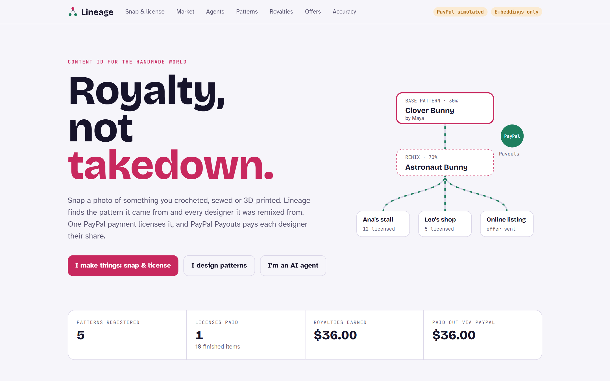
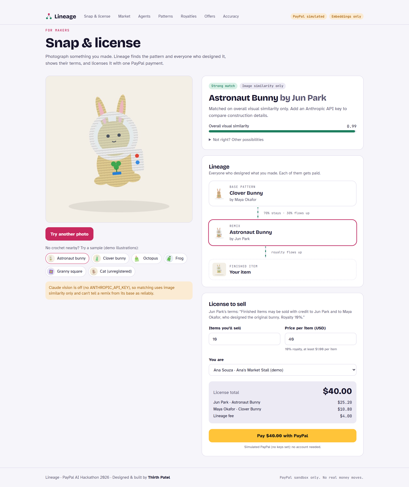
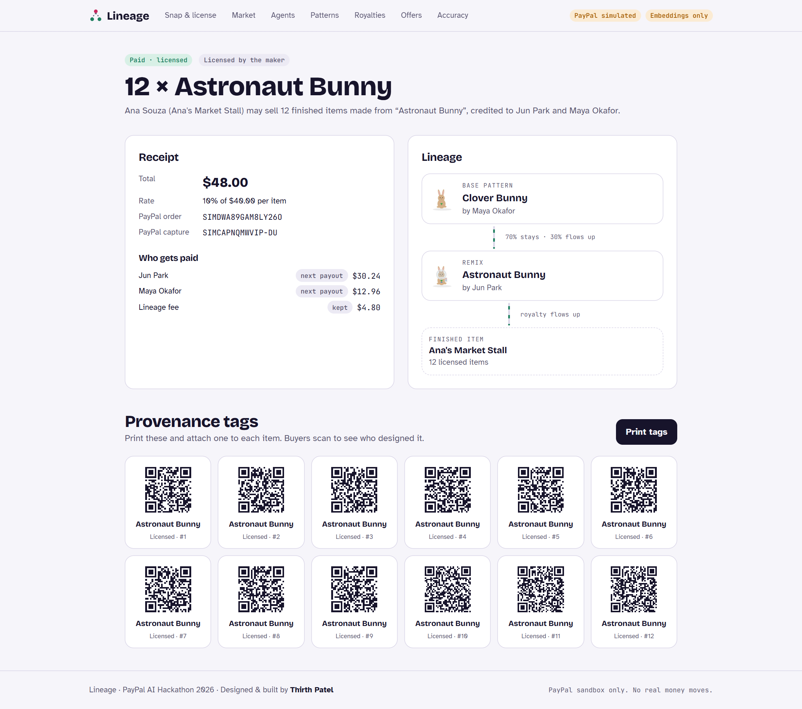
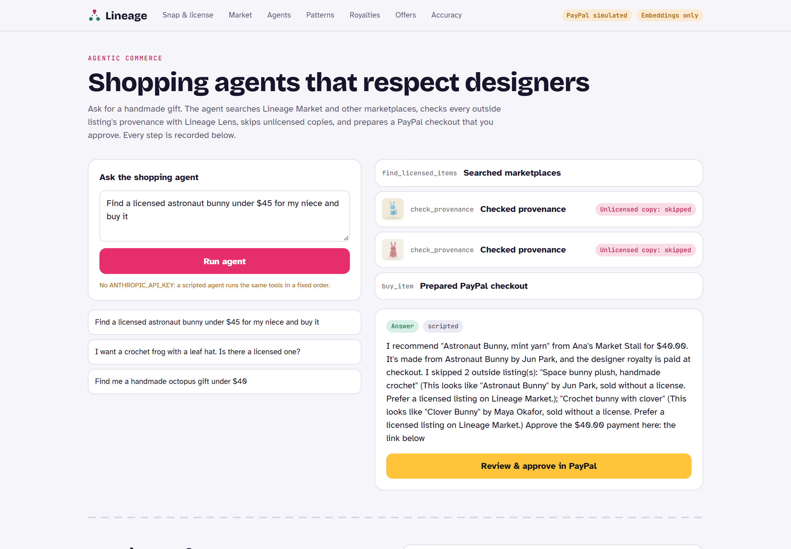
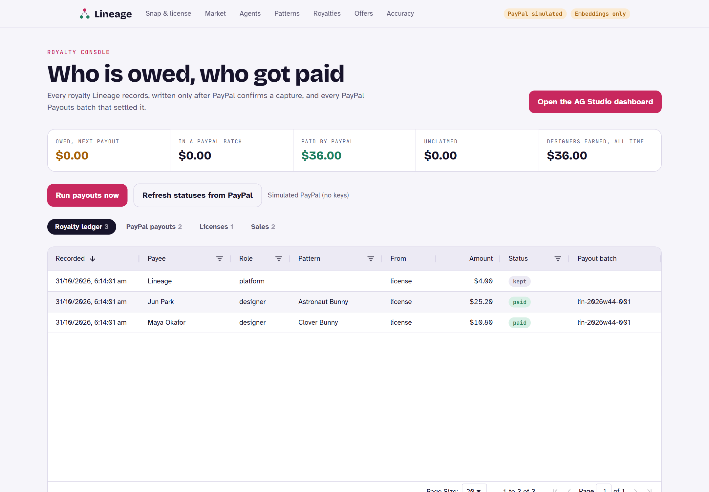
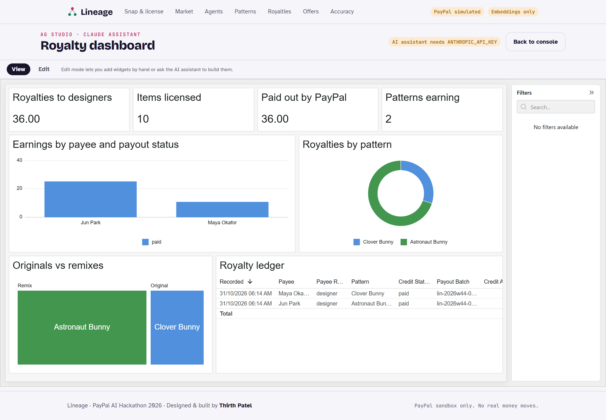
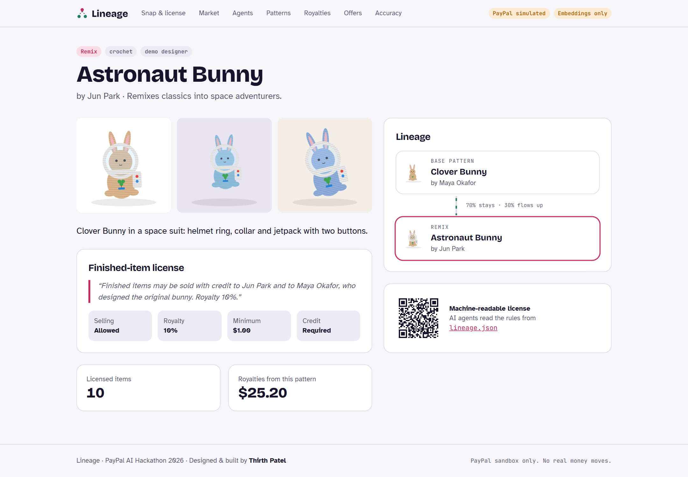
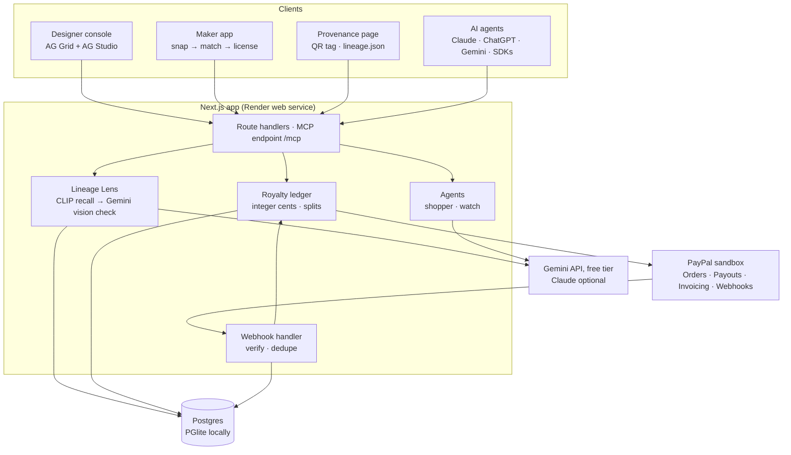

# Lineage

**Royalty, not takedown.** Lineage is Content ID for the handmade world.

A maker photographs something they crocheted, sewed or 3D-printed. Lineage finds the pattern it was made from, and every designer up the remix chain. One PayPal payment licenses it, and PayPal Payouts pays each designer their exact share. AI shopping agents can check provenance through Lineage's MCP server before they buy.

Built for the [PayPal AI Hackathon 2026](https://paypalaihackathon.devpost.com/) by **Thirth Patel**.

> Runs on the PayPal **sandbox** only. No real money moves.



| Snap & license | License receipt with QR tags |
|---|---|
|  |  |
| **Shopping agent skipping unlicensed copies** | **Royalty console (AG Grid)** |
|  |  |
| **AG Studio dashboard with an AI assistant** | **Pattern lineage and lineage.json** |
|  |  |

---

## Why

Indie pattern designers sell a crochet or sewing pattern once, for a few dollars. Finished items made from it sell for many times that. Today their only tool is a takedown report, which earns nobody anything. Makers usually want to pay, but can't tell who designed an item or how to pay them. Remixes (a bunny turned into an astronaut bunny) lose the original designer entirely.

YouTube solved this for video: when Content ID finds a match, the rights holder can take the revenue instead of removing the video. Lineage brings that to physical goods, with PayPal as the money layer.

## What it does

| | |
|---|---|
| **Snap & license** (`/snap`) | Photo in → matched pattern, its remix lineage, the designer's terms, a live quote and a PayPal checkout. |
| **Lineage Lens** | CLIP image embeddings shortlist candidates; a vision model (Gemini's free tier) compares construction details (ear shaping, a helmet ring, a jetpack) and explains its answer; plain code bands the score. Traditional designs nobody owns are never charged. |
| **Royalties up the chain** | A remix pays its designer *and* the original pattern's designer, split to the cent. |
| **Provenance tags** | Every licensed item gets a QR tag. Buyers scan it to see who designed it (`/t/...`). |
| **Lineage Market** | Finished items whose checkout splits the royalty out of each PayPal payment. |
| **Shopping agent** (`/agent`) | Gemini searches, checks outside listings' provenance, skips unlicensed copies, and prepares a PayPal checkout a person approves. Every step is recorded. |
| **MCP server** (`/mcp`) | Six tools any agent can use: `find_licensed_items`, `check_provenance`, `get_license_terms`, `quote_license`, `buy_license`, `buy_item`. |
| **`lineage.json`** | A machine-readable finished-item license on every pattern (`/patterns/<id>/lineage.json`). |
| **Watch agent** (`/offers`) | A designer submits a listing; Lineage confirms the match (and refuses when unsure), drafts a friendly offer, and sends it as a PayPal invoice once approved. |
| **Royalty console** (`/console`) | AG Grid ledger of every credit and payout, a "Run payouts" button, and an **AG Studio** dashboard with an AI-powered assistant (`/console/studio`). |
| **Accuracy report** (`/eval`) | Measured top-1 / top-3 / false-match rates from `npm run eval`. |

## How PayPal is used

| PayPal capability | Used for | Code |
|---|---|---|
| **Orders v2** (create, capture) | Maker licenses; Market purchases (including agent-prepared ones) | `src/lib/paypal.ts`, `src/lib/commerce.ts` |
| **Payouts** | Weekly batch paying every designer and maker their balance by email | `runPayouts()` in `src/lib/commerce.ts` |
| **Invoicing v2** (create, send, status) | License offers from the watch agent instead of takedowns | `createAndSendInvoice()`, `refreshOffers()` |
| **Webhooks** + signature verification | `CHECKOUT.ORDER.APPROVED`, `PAYMENT.CAPTURE.COMPLETED`, `INVOICING.INVOICE.PAID`, `PAYMENT.PAYOUTS-ITEM.*` | `src/app/api/webhooks/paypal/route.ts` |
| **Transaction Search** | "Reconcile with PayPal" in the console compares every capture with PayPal's records | `reconcile()` |

Why one platform account plus Payouts, rather than splitting each payment at checkout: royalties are often a few cents per item and are spread across several designers up a remix chain, so each payment would need many tiny splits. Many indie designers also have personal PayPal accounts, not the business accounts a checkout split pays into. Collecting once and paying everyone's combined balance in a weekly Payouts batch keeps fees and friction down, and a designer only needs an email address.

Money rules, enforced in code (`src/lib/money.ts`, `src/lib/commerce.ts`):

- Integer cents everywhere; shares in basis points; every split sums exactly (tested with 2,000 random splits).
- Ledger credits are written only after PayPal reports a `COMPLETED` capture for the **exact** expected amount.
- Capture, webhook and page refresh can race safely: only the call that flips a row from `created` writes credits.
- `PayPal-Request-Id` on every create; `sender_batch_id` (`lin-2026w45-001`) makes a payout run impossible to send twice.
- Credits are reserved before calling PayPal and released if the Payouts call fails; failed or returned items go back to the next run.
- AI never sets an amount. It can only point at a pattern.

## How AI is used

| Where | Model | What it does |
|---|---|---|
| Lens, stage 1 | CLIP ViT-B/32 (`Xenova/clip-vit-base-patch32`, runs locally on CPU via ONNX) | Image embeddings for fast recall against every registered pattern photo |
| Lens, stage 2 | Gemini Flash-Lite (free tier), vision + JSON schema output | Scores each candidate on construction features, tells remix from base, flags traditional designs, explains in plain words |
| License reader | Gemini, JSON schema output | Turns a designer's free-text terms into structured license fields the designer confirms |
| Shopping agent | Gemini function calling, in a small tool loop | Multi-step tool use over the six Lineage tools |
| Watch agent | Gemini | Writes a warm, non-threatening license offer |
| AG Studio assistant | Gemini via a custom `AgLlmAdapter` | Answers questions and builds dashboard widgets over the royalty data |

Everything AI runs at no cost: CLIP locally, and Gemini on Google's free tier. Free-tier models are sometimes busy, so each call falls back through a short list of free models. With an `ANTHROPIC_API_KEY` set instead, the same features run on Claude Opus 5.5 (paid), with server-side fallbacks.

## Accuracy

`npm run eval` runs the production matcher over a labelled test set and writes `eval/report.json` (shown at `/eval`).

| Dataset | Method | Top-1 | Top-3 | False matches | Unknown items rejected |
|---|---|---|---|---|---|
| 160 illustrated stand-ins (5 registered designs, 3 unregistered) | CLIP image similarity only | 99.0% | 100% | 0.6% | 100% |
| 40 illustrated stand-ins (same designs) | CLIP + Gemini vision (free tier) | **100%** | **100%** | **0%** | **100%** |

With vision on, every remix was told apart from its base pattern, all 10 granny squares and plain beanies were classed as traditional designs (no license offered), and all 5 unregistered cats got no match. Both runs are in `eval/`.

The CLIP-only miss was a remix confused with its base pattern; the vision step fixed it. Illustrations are easier than photographs. Run `npm run eval -- --photos ./photos` with real photographed makes (`photos/<pattern-id>/*.jpg`, unknown items in `photos/_none/`).

## Architecture



## Run it locally

Requires Node.js 20+.

```bash
npm install
npm run dev          # http://localhost:3000
```

That's all. Without a `DATABASE_URL`, Lineage uses an embedded Postgres (PGlite) in `./.data` and loads the demo data on first start. Without PayPal or AI keys it runs in a clearly labelled demo mode: a stand-in PayPal approval page and image-similarity-only matching. The header shows which mode is on.

To use the real PayPal sandbox and AI, copy `.env.example` to `.env.local` and fill it in:

1. **PayPal sandbox app**: [developer.paypal.com](https://developer.paypal.com/dashboard/applications/sandbox) > Apps & Credentials > create an app. Copy the client id and secret into `PAYPAL_CLIENT_ID` / `PAYPAL_CLIENT_SECRET`, and put the sandbox **business** account email in `PAYPAL_MERCHANT_EMAIL`. In the app's features, make sure **Payouts**, **Invoicing** and **Transaction search** are on. Use a **US** sandbox business account: PayPal refuses payouts from some regions.
2. **Sandbox accounts**: create a sandbox **personal** account to pay with. For payouts to show as claimed, set the demo designers' and makers' PayPal emails to sandbox personal accounts too.
3. **Webhooks** (deployed URL only): add `https://<your-app>/api/webhooks/paypal` with the events `CHECKOUT.ORDER.APPROVED`, `PAYMENT.CAPTURE.COMPLETED`, `INVOICING.INVOICE.PAID` and `PAYMENT.PAYOUTS-ITEM.*`, and put the webhook id in `PAYPAL_WEBHOOK_ID`. Locally the return URL and the "Refresh statuses" button cover the same ground.
4. **AI (free)**: create a free API key at [aistudio.google.com](https://aistudio.google.com/apikey) and set `GEMINI_API_KEY`. No card or billing is needed. Optionally, set `ANTHROPIC_API_KEY` instead to use Claude, which is paid.

Other scripts:

```bash
npm test            # money math, address filtering and AI request tests
npm run preflight   # real calls to the PayPal sandbox and the AI: run after adding keys
npm run e2e         # every flow in a browser, against a running server
npm run eval        # accuracy report
npm run seed        # (re)load demo data (stop the dev server first when using PGlite)
npm run build && npm start
```

## How it was tested

| Check | Against | Proves |
|---|---|---|
| `npm test` | Pure functions, intercepted HTTP | Splits are exact; private addresses are refused; AI requests are shaped as documented |
| `npm run e2e` offline | PGlite, built-in simulator | Every flow works for someone with no keys |
| `npm run e2e` live paths | Real Postgres, `scripts/mock-services.mjs` | The live PayPal and Claude code paths handle those services' documented responses |
| `npm run preflight` | The real PayPal sandbox and the Gemini API | The real services accept our requests (all passing on Nov 7: orders, invoices, payouts, Transaction Search, Gemini vision; webhooks need a deployed URL) |

The stand-in server is only as accurate as our reading of the docs, so preflight is the check that counts.

## Deploy

`render.yaml` is a Render Blueprint: a web service, a Postgres database and a weekly payout cron job. Set `APP_URL` and the keys in the dashboard. `SEED_DEMO=1` loads the demo on an empty database. Use at least the Standard plan: CLIP and ONNX Runtime need more than 512 MB.

## Project layout

```
src/lib/money.ts          Integer-cent royalty math (+ tests)
src/lib/paypal.ts         Every PayPal call, plus the offline simulator
src/lib/commerce.ts       Checkout, capture → ledger, payouts, invoice offers
src/lib/ai/lens.ts        Lineage Lens: CLIP recall → vision verification → bands
src/lib/ai/gemini.ts      Gemini free tier: structured answers, free-model fallback
src/lib/ai/embed.ts       Local CLIP embeddings
src/lib/agent-tools.ts    The six agent tools (shared by /mcp and the shopping agent)
src/lib/agents/           Shopping agent and watch agent
src/app/mcp/route.ts      MCP server (Streamable HTTP)
src/app/api/ai/claude/    AG Studio ↔ Gemini/Claude adapter (server side)
scripts/eval.ts           Accuracy evaluation
```

## Demo data and honesty notes

- Demo designers, makers and photos are fictional and flagged `demo`. The photos are illustrations generated in code (`src/lib/demo-art.ts`) until real photographed makes replace them. We never scrape marketplaces.
- "Sample outside marketplace" listings in the agent demo are labelled demo data; with `CHANNEL3_API_KEY` set, outside results come from Channel3.
- The app has no user accounts: it is a single-tenant demo. Payout and console endpoints are open so judges can try them; put them behind auth before any real use. Claude-backed endpoints are rate limited, with a daily ceiling (`AI_DAILY_LIMIT`).
- Whether a designer can restrict finished-item sales is legally unsettled in places. Lineage sells voluntary licenses and never files takedowns.

## License

MIT. See [LICENSE](LICENSE).
